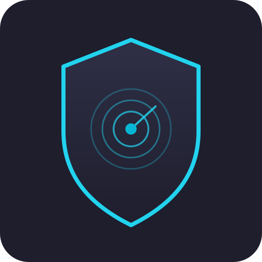

<div align="center">



# Sentinel WAF

**Dashboard manajemen WAF berbasis ModSecurity + OWASP CRS** - rule, TLS,
rate limiting, dan log, semuanya dari satu dashboard web.

[](https://github.com/Mar0x02/sentinel-waf)

</div>

---

Bukan WAF baru dengan engine sendiri, tapi layer manajemen di atas
ModSecurity yang bikin pengelolaannya semudah tool WAF komersial (gaya
SafeLine): rule, reverse proxy, TLS, rate limiting, dan log semuanya
diatur lewat dashboard web, bukan edit file `.conf` manual atau
`docker exec` ke container.

Semua state (rule set yang diimport, rule yang aktif/nonaktif, daftar site,
tujuan forward log) tersimpan di **PostgreSQL**, bukan cuma file - jadi
auditable dan gampang di-manage dari satu tempat.

## Tujuan

Proyek ini lahir dari kebutuhan lab pribadi: pengelolaan ModSecurity +
OWASP CRS yang masih serba manual - edit `crs-setup.conf` langsung,
`docker exec` ke container buat reload, nebak-nebak `tx.*` variable mana
yang udah/belum di-set, dan sebagainya. Sentinel WAF dibuat supaya semua
itu bisa dikerjakan dari satu dashboard web: import/tuning CRS tinggal
klik, nulis custom rule dibantu validasi otomatis (dashboard ngecek sendiri
kalau ada `tx.*`/collection variable yang kepake tapi belum didefinisikan,
terus nawarin cara benerinnya), dan semua perubahan langsung diterapkan ke
WAF tanpa perlu masuk ke container sama sekali.

## Fitur

- **Rule management berbasis database** - import OWASP CRS tinggal pilih
  dari daftar versi yang tersedia atau paste URL rule package custom.
  Setiap rule yang masuk tercatat sebagai baris di database, bisa
  diaktifkan/nonaktifkan per file rule atau per rule ID individual (lewat
  `SecRuleRemoveById`, tanpa pernah menyentuh file asli vendor).
- **CRS Tuning** - atur paranoia level & anomaly score threshold
  (blocking/detection/inbound/outbound) langsung dari form, gak perlu tau
  syntax ModSecurity. `crs-setup.conf` juga bisa diedit manual kalau mau
  atur hal lain di luar itu (file rule bawaan CRS lainnya tetap terkunci).
- **Tunable lain otomatis ke-detect** - di luar paranoia/anomaly, dashboard
  nyari sendiri semua knob tuning lain di file setup (contoh:
  `max_file_size`, `allowed_methods`, `restricted_extensions`, dst - ada
  ~22 di CRS) dan nampilin sebagai list yang bisa diaktifin/diedit
  langsung, gak perlu hardcode per-variable atau nulis syntax manual.
- **Base Tuning (scoring mandiri, gak butuh CRS)** - rule set bawaan yang
  selalu ada sejak awal deploy, independen dari CRS diimport atau nggak.
  Nyediain mekanisme "akumulasi skor lalu block kalau lewat threshold"
  yang sama kayak CRS, tapi bisa dipakai custom rule kamu sendiri. Isinya
  minimal dari awal (cuma 1 nilai default yang aman) dan **tumbuh otomatis
  sesuai kebutuhan** - begitu custom rule referensi variable yang belum
  ada, dashboard nawarin nambahin otomatis (atau manual, pilihan kamu).
- **Validasi otomatis buat custom rule** - tiap kali nyimpen custom rule,
  dashboard ngecek 3 hal: (1) variable `tx.*` yang dipake tapi belum pernah
  di-`setvar`, (2) collection `ip`/`session`/`user` yang dipake tapi belum
  di-`initcol`, (3) counter yang di-increment tapi gak pernah dicek rule
  manapun (jadi gak pernah ngaruh ke apa-apa). Tiap warning dikasih
  tombol fix sekali klik kalau memungkinkan, atau bisa dibenerin manual.
- **Reverse proxy (Sites)** - daftarkan domain + upstream backend dari
  dashboard, langsung jadi server block nginx yang otomatis dilindungi
  oleh rule yang aktif.
- **HTTPS per-site (upload certificate manual)** - aktifkan HTTPS buat
  site tertentu dengan upload certificate + private key sendiri (paste
  langsung atau upload file `.crt`/`.key`). Port HTTP otomatis redirect
  301 ke HTTPS begitu diaktifkan. Belum ada otomasi Let's Encrypt - lihat
  bagian Keterbatasan.
- **Rate limiting per-site** - batasi request/detik per IP (dengan burst
  allowance) dan/atau jumlah koneksi bersamaan per IP, per site. Request
  yang kelebihan dapat response `429` (pakai custom error page sendiri).
- **Log forwarding** - audit log ModSecurity bisa diarahkan ke syslog
  server eksternal (SIEM, dst), selain tetap bisa dilihat langsung di
  dashboard (trend serangan, top rule yang ke-trigger, top IP penyerang,
  globe interaktif asal-negara request). Tiap baris log di tab **Logs**
  bisa diklik buat liat detail lengkap: host tujuan, User-Agent pengirim,
  dan semua rule yang cocok beserta pesan/severity/tags/data-nya.
- **Notifikasi Discord** - tiap request yang diblokir WAF langsung kekirim
  ke channel Discord (di-batch biar gak kena rate-limit webhook Discord
  pas lagi diserang rame). Atur dari tab Settings, khusus Admin. Cara
  dapet webhook URL: di Discord, Server Settings → Integrations →
  Webhooks → New Webhook, pilih channel-nya, copy URL-nya, paste di sini.
- **Live reload otomatis** - perubahan rule, site, TLS, atau rate limit
  dari dashboard langsung diterapkan ke container WAF tanpa restart manual.
- **Custom error pages** - halaman HTML yang ditampilkan untuk status 403
  (diblokir WAF), 429 (rate limited), 413 (payload kebesaran), dan 503
  (service unavailable) bisa diedit langsung dari dashboard, lengkap
  dengan preview dan tombol reset ke default.
- **Login & bahasa** - dashboard terkunci di belakang login admin (password
  awal di-generate otomatis, lihat bagian Login di bawah), dan tersedia
  dalam Bahasa Indonesia atau English (tinggal toggle).
- **Team & role** - tambah anggota tim dengan 3 level akses: **Admin**
  (full akses + kelola user lain), **Operator** (kelola rule/site/error
  page sehari-hari), **Viewer** (read-only). Dikelola dari tab **Team**
  (cuma keliatan buat Admin).
- **WAF Engine Settings** - atur perilaku global ModSecurity langsung dari
  dashboard (mode audit logging, limit ukuran body request/response, MIME
  type yang diperiksa) - gak perlu lagi ubah environment variable di
  `docker-compose.yml`. Khusus Admin, di tab **Settings**. Ada juga bagian
  **Advanced** (udah ada template directive umum, tinggal hapus `#` buat
  aktifin) buat nulis directive ModSecurity mentah apa aja yang belum
  ke-cover field biasa - kalau syntax-nya salah, WAF otomatis tetap pakai
  config lama (gak down), tinggal dicek & diperbaiki.

## Arsitektur

Terdiri dari 5 container terpisah (docker compose):

| Container       | Peran |
|-----------------|-------|
| `postgres`      | Menyimpan state: rule sets/files/rules, sites, log sinks |
| `backend`       | FastAPI - API dashboard, merender state DB jadi config untuk WAF |
| `frontend`      | Dashboard web (React) |
| `waf-engine`    | Jalur traffic sebenarnya: nginx + ModSecurity v3 + OWASP CRS |
| `log-forwarder` | Membaca audit log dan meneruskannya ke syslog sink yang dikonfigurasi |

`backend` dan `waf-engine` tidak saling memanggil API secara langsung -
komunikasinya lewat Docker named volume yang di-share: backend menulis
config hasil render, `waf-engine` memantau volume tersebut dan otomatis
reload nginx saat ada perubahan.

### Mode dev vs production

Dua cara jalanin stack-nya, beda di jumlah port yang perlu dibuka buat
akses dashboard - bukan beda kode, cuma beda cara di-build/di-serve:

| | `docker-compose.yml` (default) | `docker-compose.prod.yml` |
|---|---|---|
| Frontend | Vite dev server | React di-build jadi static file, di-serve nginx |
| Backend | expose port `8000` ke host | **tidak** expose ke host, cuma internal |
| Port dashboard | `5173` (UI) + `8000` (API) terpisah | `8000` doang, API-nya di-proxy nginx lewat `/api/*` |
| Cocok buat | development/testing lokal | deploy ke VM/server sungguhan |

Kalau dashboard-nya diakses dari mesin lain (bukan dari VM itu sendiri) -
misal lab kamu pakai firewall kayak pfSense - mode production jauh lebih
gampang: cuma **1 port** (`8000`) yang perlu di-allow buat dashboard, bukan
2 (`5173` dan `8000` terpisah). Port WAF traffic (`8080`/`8443`) tetap sama
di kedua mode, itu jalur terpisah dari dashboard. `8000` dipilih (bukan
`80`) biar gak butuh root buat bind port-nya dan gak bentrok kalau port
`80` udah dipakai hal lain di host (misal jalur WAF traffic sendiri kalau
di-mapping ke `80`).

Jalanin mode production:

```bash
./install.sh --prod
# atau manual:
docker compose -f docker-compose.prod.yml up -d --build
```

Data (Postgres, rule, site, dst) **sama-sama kepake** di kedua mode kalau
dijalanin di checkout yang sama - jadi bisa pindah dari dev ke production
(atau sebaliknya) tanpa kehilangan data.

## Prasyarat

- [Docker](https://docs.docker.com/get-docker/) dan Docker Compose v2
  (sudah dites dengan Docker 29.x / Compose v5.x)
- Mode dev: port `5173`, `8000`, `8080`, dan `8443` (kalau pakai HTTPS
  per-site) tersedia di mesin kamu. Mode production: cukup `8000`, `8080`,
  dan `8443`.
- Koneksi internet (buat download image dasar + rule OWASP CRS saat import
  pertama kali)

## Cara Pakai

Alur lengkap dari nol: clone repo → jalankan → login → pakai dashboard →
(kalau perlu) reset password atau hapus total. Tiap langkah di bawah bisa
di-copy-paste langsung ke terminal.

### 1. Clone & jalankan

```bash
# Clone repo ini
git clone https://github.com/Mar0x02/sentinel-waf.git
cd sentinel-waf

# Build + start semua service di background, lalu begitu backend siap,
# langsung tampilkan username + password admin awal di terminal ini -
# gak perlu command tambahan.
./install.sh

# Deploy ke VM/server sungguhan (1 port buat dashboard, bukan 2) -
# lihat "Mode dev vs production" di atas:
./install.sh --prod
```

`install.sh` itu cuma wrapper tipis di atas `docker compose up -d --build`
yang nunggu backend siap sebelum nampilin credential - stack-nya sendiri
tetap jalan di background seperti biasa setelah installer selesai. Kalau
mau jalanin manual tanpa installer: `docker compose up -d --build`, lalu
`docker compose logs backend | grep -A5 "admin account created"`.

Setelah itu buka (mode dev):

- **Dashboard**: `http://localhost:5173`
- **Backend API**: `http://localhost:8000` (opsional, cuma kalau mau cek API langsung)
- **WAF (jalur traffic)**: `http://localhost:8080` (HTTP) / `https://localhost:8443` (HTTPS per-site yang diaktifkan) - ini yang nantinya jadi tujuan trafik situs yang dilindungi

Atau (mode production, `--prod`):

- **Dashboard**: `http://localhost:8000` (API sudah termasuk lewat proxy)
- **WAF (jalur traffic)**: sama kayak di atas, `8080`/`8443`

### 2. Login pertama kali

Dashboard butuh login - **tidak ada password default yang bisa ditebak**.
`install.sh` nampilin username + password admin itu langsung di terminal.
Password ini **cuma ditampilkan sekali** (gak pernah disimpan dalam bentuk
plaintext di mana pun), kira-kira begini:

```
==================================================================
  Sentinel WAF - initial admin account created
  username: admin
  password: <random, cuma muncul sekali di sini>
==================================================================
```

Login pakai username `admin` + password itu di `http://localhost:5173`.
Dashboard bakal langsung minta kamu ganti password itu ke password sendiri
sebelum bisa lanjut pakai fitur lain.

Akun pertama ini otomatis role **Admin**. Buat nambah anggota tim lain
(dengan role Operator atau Viewer), lihat bagian **Team** di bawah.

### 3. Pakai dashboard

Begitu login, dashboard masih **kosong rule custom** (sengaja - gak ada
CRS otomatis ter-load dari image vendor, biar semua rule yang aktif
benar-benar tercatat lewat dashboard). Satu-satunya yang udah ada dari
awal adalah rule set **Base Tuning** (lihat Fitur di atas), isinya minimal
dan gak ngaruh ke traffic sampai ada custom rule yang benar-benar butuh.

1. **Tab Rules** → import OWASP CRS versi terbaru dari daftar katalog
   (tinggal klik "Import"), atau langsung mulai nulis custom rule sendiri
   di rule set **Custom Rules**.
2. Nulis custom rule yang referensi `tx.*`/`ip.*` variable yang belum
   ada? Dashboard bakal nunjukin warning pas disimpan, lengkap sama
   pilihan fix otomatis (klik) atau manual - gak perlu nebak-nebak sendiri
   variable mana yang kurang.
3. **Tab Sites** → tambahkan domain + upstream backend aplikasi yang mau
   dilindungi (misal `shop.example.com` → `http://app-backend:3000`).
   Di form yang sama bisa langsung aktifin **HTTPS** (upload cert+key) dan
   **rate limiting** (request/detik + max koneksi per IP) kalau perlu.
4. Arahkan trafik ke `http://localhost:8080` (atau `:8443` buat site yang
   HTTPS-nya aktif) dengan header `Host` sesuai domain yang didaftarkan di
   langkah 3 (atau setup DNS/reverse proxy di depannya kalau mau diakses
   pakai domain asli).
5. **Tab Logs** / **Dashboard** buat memantau request yang di-block atau
   terdeteksi mencurigakan.
6. **Tab Settings** kalau mau meneruskan log ke syslog server eksternal
   (SIEM, dst) atau notifikasi Discord.

### 4. Reset password (lupa / curiga ada yang akses)

```bash
./reset-admin.sh            # reset akun "admin"
./reset-admin.sh namauser   # reset akun user lain (berlaku buat role apa aja)
```

Password langsung di-generate ulang (random) dan ditampilkan sekali di
terminal, mirip `./install.sh`. **Semua sesi login yang lagi aktif - buat
semua user, bukan cuma yang di-reset - otomatis ke-logout** (jaga-jaga
kalau reset-nya karena curiga ada yang akses tanpa izin). Login lagi pakai
password baru itu, nanti diminta ganti lagi.

### 5. Stop atau hapus total

```bash
docker compose down        # stop semua container, data tetap tersimpan
docker compose down -v     # stop + hapus SEMUA data (rule, site, log, akun, dst)
```

Pakai `down` biasa kalau cuma mau mematikan sementara (data tetap ada pas
dinyalain lagi dengan `docker compose up -d`, atau jalanin `./install.sh`
lagi). Pakai `down -v` kalau mau bener-bener reset dari nol - abis itu
jalanin `./install.sh` lagi buat install ulang dari kosong (dapat admin
password baru lagi).

Kalau lagi jalanin mode production, tambahin `-f docker-compose.prod.yml`
di command-nya: `docker compose -f docker-compose.prod.yml down` (atau
`down -v`).

## Team (kelola anggota & role)

Tab **Team** (cuma keliatan buat user dengan role Admin) buat nambah,
hapus, atau ubah role anggota tim:

- **Admin** - full akses, termasuk kelola user lain dan log forwarding.
- **Operator** - kelola Rules/Sites/Error Pages sehari-hari, **tidak**
  bisa kelola user atau pengaturan log forwarding.
- **Viewer** - read-only di semua halaman (Dashboard, Logs, Rules, Sites,
  dst), gak bisa ubah apa-apa.

Pas nambah user baru, Admin yang set password awalnya langsung (gak ada
invite link via email) - user itu wajib ganti password sendiri pas login
pertama. Admin juga bisa reset password teammate kapan aja dari tab ini
(tombol **Reset password**) - sama efeknya kayak `./reset-admin.sh`, semua
sesi login ke-logout.

## Struktur folder

```
backend/          FastAPI app (Postgres via SQLAlchemy)
  app/adapters/     parser audit log per format WAF engine
  app/services/     importer rule package, render_service (DB -> config file)
  app/api/          HTTP routes
frontend/          Dashboard React + Vite
waf-engine/        Dockerfile custom di atas owasp/modsecurity-crs:nginx
log-forwarder/     Sidecar kecil (Python stdlib) buat forward log ke syslog
docker-compose.yml
```

## Keterbatasan saat ini

- **TLS otomatis (Let's Encrypt/ACME) belum ada** - HTTPS per-site baru
  bisa lewat upload certificate manual (lihat Fitur di atas).
- **Persistent collection ModSecurity (`ip`/`session`/`user`) tidak bisa
  diandalkan** - dikonfirmasi lewat testing langsung (debug log + request
  nyata) bahwa engine yang dipakai (`libmodsecurity3`/ModSecurity v3)
  tidak benar-benar menyimpan collection ini lintas-request, walau
  `initcol` sudah benar. Jadi pola "counter per-IP lintas request" (misal
  lockout brute-force manual lewat rule) gak bisa dipakai di sini -
  **pakai rate limiting per-site** (fitur di atas) buat kebutuhan serupa.
- **Blocking di fase response body (phase:4) tidak bisa rapi** -
  dikonfirmasi lewat testing langsung (debug log + request nyata, kasus
  kebocoran error PHP/SQL DVWA): nginx mengirim status line dan header ke
  client segera setelah diterima dari upstream, **sebelum** ModSecurity
  selesai memeriksa seluruh response body di fase 4. Kalau rule
  response-body (mis. CRS `RESPONSE-950..956`, deteksi kebocoran
  error/stack trace) baru mutusin untuk block setelah itu, status code
  yang sudah terkirim (`200 OK`) tidak bisa ditarik/diganti - nginx
  melempar `header already sent` dan koneksi terputus paksa, bukan
  menampilkan halaman block 403 yang rapi. Ini keterbatasan arsitektur
  nginx+ModSecurity v3 connector, bukan bug di kode Sentinel WAF - dan
  gak bisa diperbaiki dengan tuning `proxy_buffering`/`proxy_buffers`
  karena masalahnya ada di header yang dikirim terpisah (dan lebih dulu)
  dari body. Field `status`/`blocked` di audit log tetap akurat
  merepresentasikan **keputusan ModSecurity**, bukan apa yang benar-benar
  diterima client di jaringan. Rule response-body tetap andal untuk
  **deteksi dan logging** (termasuk ke syslog sink) - yang gak andal
  cuma eksekusi block-nya. Kalau blocking di fase ini mengganggu (client
  dapet connection reset alih-alih halaman block), naikkan
  `outbound_anomaly_score_threshold` di CRS Tuning ke nilai yang praktis
  gak akan tercapai (mis. `1000`) supaya rule-nya tetap jalan/logging
  tanpa pernah mencoba block.
- **Load balancing ke banyak upstream server per site belum ada** - satu
  Site cuma bisa punya satu `upstream_url`.
- Mode WAF (enforce/detection) masih global, belum bisa per-site.
- Audit log belum di-ingest ke Postgres (dashboard baca langsung dari file log).
- Log sink baru mendukung syslog (webhook/Elasticsearch belum ada).
- Belum ada schema migration tool (Alembic) - skema dibuat otomatis saat
  startup, perubahan kolom di tabel existing butuh `ALTER TABLE` manual.
- Dukungan Apache + mod_security2 belum diimplementasikan (baru ModSecurity v3/nginx).
